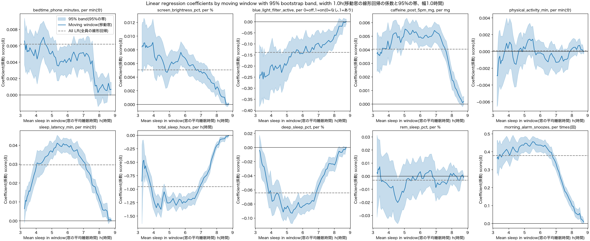
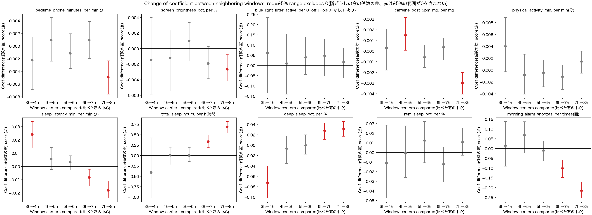
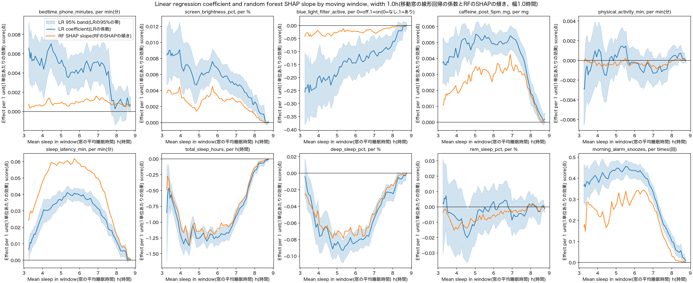
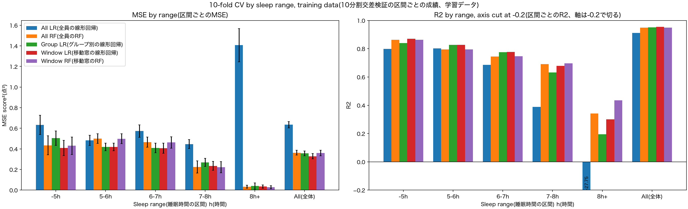
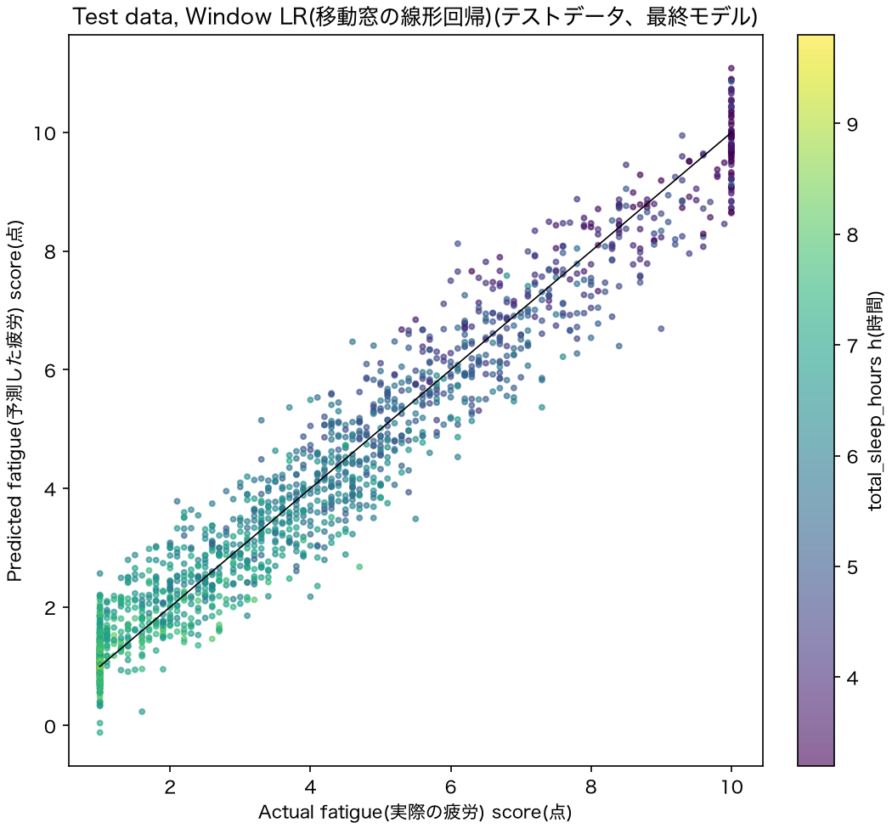

# Fatigue Factors and Sleep Duration(睡眠時間と疲労要因の分析)

> How the effect of each behavioural factor on next-day fatigue changes with sleep duration, analysed with moving windows over sleep, linear regression and random forest
> (各行動要因が翌日の疲労に与える影響が睡眠時間によってどう変わるかを、睡眠時間の移動窓・線形回帰・ランダムフォレストで分析する)

---

## Project overview(プロジェクトの概要)

A prior study on the same dataset ([veryze/sleep-optimisation](https://github.com/veryze/sleep-optimisation)) fitted one linear regression and one random forest to everyone and ranked the factors. This assumes that, for example, 1 minute of bedtime phone use raises fatigue by the same amount for a person who sleeps 4 hours and for a person who sleeps 8 hours.
(同じデータを使った先行研究は、全員に線形回帰と RF を1つずつ当てはめて要因を順位づけした。これは、たとえば寝る前のスマホ1分が疲労を上げる量が、4時間睡眠の人と8時間睡眠の人で同じだと仮定している。)

This project tests that assumption. Linear regressions are fitted in 1.0-hour windows of sleep duration moved by 0.1 hours, and the coefficient of each factor is followed along sleep duration.
(このプロジェクトはその仮定を確かめる。睡眠時間の幅1.0時間の窓を0.1時間ずつ動かして窓ごとに線形回帰を作り、各要因の係数が睡眠時間に沿ってどう動くかを見る。)

### Research question(研究課題)

> **How does the effect of each behavioural factor (e.g., bedtime phone use, caffeine) on next-day fatigue change with sleep duration?**
> (寝る前のスマホ利用やカフェインなどの各要素が翌日の疲労に与える影響は、睡眠時間によってどのように変わるか？)

Moving windows over sleep duration are the main method, following Oliver's suggestion.
(Oliver の提案に従い、睡眠時間の移動窓を中心の方法にする。)

---

## Dataset(データ)

| Attribute(項目) | Details(内容) |
|---|---|
| **Source(出典)** | Sleep Debt and Screen Time: Late-Night Phone Habits (Kaggle, samartalwar) https://www.kaggle.com/datasets/samartalwar/sleep-debt-and-screen-time-late-night-phone-habits |
| **License(ライセンス)** | CC BY-SA 4.0 https://creativecommons.org/licenses/by-sa/4.0/ |
| **Size(大きさ)** | 8,500 rows × 18 columns(8,500行×18列), 1 person per row(1人1行) |
| **Target(目的変数)** | `next_day_fatigue_score`, 1.0-10.0, mean 3.79(平均3.79) |
| **Missing / duplicates(欠損・重複)** | None(なし) |
| **Changes(変更)** | None. The file is redistributed as downloaded(なし。ダウンロードしたまま再配布) |

### Features used(使った特徴量)

| Category(分類) | Feature(特徴量) | Unit(単位) | Mean(平均) | Range(範囲) |
|---|---|---|---|---|
| **Screen use(画面の利用)** | `bedtime_phone_minutes` | min(分) | 59.3 | 1-180 |
| | `screen_brightness_pct` | % | 55.2 | 10-100 |
| | `blue_light_filter_active` | 0=off,1=on(0=なし,1=あり) | 0.47 | 0-1 |
| **Lifestyle(生活習慣)** | `caffeine_post_5pm_mg` | mg | 33.2 | 0-250 |
| | `physical_activity_min` | min(分) | 35.7 | 0-112 |
| **Sleep(睡眠)** | `sleep_latency_min` | min(分) | 40.7 | 6-123.3 |
| | `total_sleep_hours` | h(時間) | 6.27 | 3.2-9.8 |
| | `deep_sleep_pct` | % | 21.7 | 8.1-28.0 |
| | `rem_sleep_pct` | % | 19.1 | 9.6-27.0 |
| | `morning_alarm_snoozes` | times(回) | 2.77 | 0-7 |

Dropped columns(除いた列):

- `user_id`:ID only(IDなので)
- `sleep_debt_category`:made from sleep duration, so it leaks the answer(睡眠時間から作られた列で、答えが混ざるため)
- `age`, `gender`, `occupation_type`, `chronotype`, `primary_bedtime_app`:not behavioural factors. Their differences in fatigue mostly go through sleep duration, e.g. Night Owl sleeps 5.01h with fatigue 5.40, Morning Lark sleeps 7.38h with fatigue 2.53(行動要因ではないため。疲労の違いはほぼ睡眠時間を通したもの。例：夜型は睡眠5.01時間で疲労5.40、朝型は7.38時間で2.53)

### Points found in Step 2(Step 2 でわかったこと)

| Item(項目) | Value(値) |
|---|---|
| Fatigue at 1.0, the floor(疲労1.0の人数) | 2,110 (24.8%) |
| Fatigue at 10.0, the ceiling(疲労10.0の人数) | 314 (3.7%) |
| Sleep at 3.2h, the floor(睡眠3.2時間の人数) | 242 |
| Fatigue 1.0 ratio at 8h+(8時間以上で疲労1.0の割合) | 94.7% |
| Correlation, phone vs sleep latency(スマホと寝つくまでの時間の相関) | 0.858 |
| Correlation, sleep vs snoozes(睡眠時間とスヌーズの相関) | -0.831 |
| Correlation with fatigue(疲労との相関) | snoozes 0.881, sleep -0.879, latency 0.745, phone 0.711 |

---

## Methodology(方法)

### Preprocessing and split(前処理と分割)

- **Scaling(標準化)**:not done. Coefficients stay in original units, read as "fatigue points per 1 minute, 1 mg, 1 hour". Standardized coefficients would change with the spread of each window and could not be compared across windows(行わない。係数は元の単位のままで「1分・1mg・1時間あたり疲労が何点変わるか」と読む。標準化した係数は窓ごとのばらつきで変わり、窓どうしで比べられなくなる)
- **Outliers, floor and ceiling(外れ値と上下限)**:kept as is(そのまま残す)
- **Train/test split(学習とテストの分割)**:80/20, 6,800 train and 1,700 test, stratified by 10-minute sleep bins, random_state=42. KS statistic of sleep between train and test 0.0059(80/20、学習6,800人・テスト1,700人。10分ごとの睡眠時間で層化。学習とテストの睡眠時間の KS 統計量0.0059)
- **Test data(テストデータ)**:not used until Step 10, and used only once(Step 10 まで使わず、1回だけ使う)

### Models(モデル)

| Model(モデル) | Description(内容) | Settings(設定) |
|---|---|---|
| **All LR(全員の線形回帰)** | One OLS for all 6,800 people(全員で最小二乗法の線形回帰を1つ) | - |
| **All RF(全員のRF)** | One random forest for everyone(全員でRFを1つ) | max_depth 11, min_samples_leaf 2, 100 trees. Chosen from 192 combinations by 5-fold CV(192通りから5分割交差検証で選んだ) |
| **Group LR(グループ別の線形回帰)** | One OLS per sleep group: -5h, 5-6h, 6-7h, 7-8h, 8h+(睡眠時間グループごとに線形回帰) | - |
| **Window LR(移動窓の線形回帰)** | One OLS per moving window(移動窓ごとに線形回帰) | Width 1.0h, step 0.1h(幅1.0時間、ずらし幅0.1時間) |
| **Window RF(移動窓のRF)** | One random forest per moving window(移動窓ごとにRF) | max_depth 10, min_samples_leaf 2, 100 trees. Chosen from 15 combinations by 5-fold CV(15通りから5分割交差検証で選んだ) |

### Moving windows(移動窓)

- A window with center c holds people with c-0.5 ≤ sleep < c+0.5. Centers move by 0.1h from 3.0h to 9.8h (69 windows)(中心cの窓には、睡眠時間がc-0.5以上c+0.5未満の人が入る。中心は3.0〜9.8時間を0.1時間ずつ、69個)
- A window with fewer than 100 people is not fitted. A window where everyone has the same fatigue predicts that value. With width 1.0h, 60 windows (3.0-8.9h) have a model and 6 windows from 9.0h have fatigue 1.0 for everyone(100人未満の窓は学習しない。疲労が全員同じ窓はその値を予測にする。幅1.0時間では60個の窓（3.0〜8.9時間）にモデルがあり、9.0時間からの6個は疲労が全員1.0)
- One person is in several windows. Their predictions are averaged with triangular weights, 1 at the center and 0 at the edge(1人は複数の窓に入る。窓の予測を、中心で1・端で0の三角形の重みで平均する)
- The width was chosen from 0.25, 0.5, 1.0, 1.25 and 1.5h by 5-fold CV(幅は0.25、0.5、1.0、1.25、1.5時間から5分割交差検証で選んだ)

### Testing whether an effect changes(効果が変わるかの確かめ方)

- **Bootstrap bands(ブートストラップの帯)**:the 6,800 training rows are resampled 200 times, and a 95% band is made for each window coefficient(学習データ6,800人を200回選び直し、窓ごとの係数に95%の帯をつける)
- **Neighbor comparisons(隣どうしの比べ)**:windows centered at 3, 4, 5, 6, 7 and 8h are compared with their neighbor, 10 features × 5 pairs = 50 comparisons. If the 95% range of the coefficient difference does not include 0, the effect is taken to change. About 2.5 of 50 can exclude 0 by chance(中心3、4、5、6、7、8時間の窓を隣どうしで比べる。10特徴量×5組＝50回。係数の差の95%の範囲が0を含まなければ、効果が変わったと考える。50回のうち2.5回ほどは偶然でも0を含まなくなる)
- **Random forest check(RFでの確認)**:in each window, the SHAP slope = cov(x, SHAP)/var(x) is compared with the linear regression coefficient. It has the same unit(窓ごとに SHAP の傾き＝cov(x, SHAP)/var(x) を線形回帰の係数と比べる。単位は同じ)

### Model evaluation(モデルの評価)

- **Step 9, CV(交差検証)**:10-fold CV inside the training data. MSE and R² for each sleep range. Differences are tested with the Nadeau-Bengio corrected t-test and Holm's correction(学習データで10分割交差検証。睡眠時間の区間ごとにMSEとR²。差は Nadeau–Bengio の補正つき t検定と Holm の補正で検定)
- **Best model by range(区間別の最良モデル)**:in each range, the model with the smallest CV MSE is used(区間ごとに交差検証MSEが一番小さいモデルを使う)
- **Step 10, test(テスト)**:test MSE and R², and the 95% range of the MSE difference from 2,000 paired bootstrap samples(テストのMSEとR²、2,000回の対応ありブートストラップによるMSEの差の95%の範囲)
- **Final model rule, fixed before the test(テスト前に決めた最終モデルのルール)**:the best model by range is used only if its difference from Window LR is entirely below 0. Otherwise the simpler Window LR is used(区間別の最良モデルは、移動窓の線形回帰との差がすべて0より下のときだけ使う。そうでなければ単純な移動窓の線形回帰を使う)

---

## Results(結果)

### Baseline: one linear regression for everyone(ベースライン：全員で1つの線形回帰)

Train MSE 0.6322, R² 0.9119, intercept 8.2255(学習データのMSE 0.6322、R² 0.9119、切片8.2255)

| Feature(特徴量) | Coefficient per 1 unit(1単位あたりの係数) | Unit(単位) |
|---|---|---|
| `total_sleep_hours` | -0.9517 | h(時間) |
| `morning_alarm_snoozes` | +0.3797 | times(回) |
| `blue_light_filter_active` | -0.1379 | 0/1 |
| `deep_sleep_pct` | -0.0642 | % |
| `sleep_latency_min` | +0.0297 | min(分) |
| `bedtime_phone_minutes` | +0.0062 | min(分) |
| `screen_brightness_pct` | +0.0051 | % |
| `caffeine_post_5pm_mg` | +0.0040 | mg |
| `rem_sleep_pct` | -0.0030 | % |
| `physical_activity_min` | +0.0001 | min(分) |

### Window width(窓の幅)

| Model(モデル) | Mean 5-fold CV MSE(5分割交差検証MSEの平均) |
|---|---|
| All LR(全員の線形回帰) | 0.63432 |
| Window LR, width 0.25h | 0.33705 |
| Window LR, width 0.5h | 0.32940 |
| **Window LR, width 1.0h** | **0.32829** |
| Window LR, width 1.25h | 0.32965 |
| Window LR, width 1.5h | 0.33213 |

Every width roughly halves the error of one linear regression for everyone. 1.0h is used from Step 7 on(どの幅でも、全員で1つの線形回帰の誤差がほぼ半分になる。Step 7 以降は1.0時間を使う)



### Answer to the research question(研究課題への答え)

Coefficient per 1 unit at each window center, in fatigue points(各窓の中心での1単位あたりの係数、単位は疲労の点)

| Feature(特徴量) | 3h | 4h | 5h | 6h | 7h | 8h | Changes at(効果が変わった組) | RF-LR correlation(RFとLRの相関) |
|---|---|---|---|---|---|---|---|---|
| `bedtime_phone_minutes` | 0.0066 | 0.0044 | 0.0053 | 0.0042 | 0.0052 | 0.0003 | 7h→8h | 0.244 |
| `screen_brightness_pct` | 0.0084 | 0.0070 | 0.0058 | 0.0067 | 0.0048 | 0.0022 | 7h→8h | 0.936 |
| `blue_light_filter_active` | -0.2555 | -0.1938 | -0.1841 | -0.1443 | -0.0966 | -0.0798 | none(なし) | 0.895 |
| `caffeine_post_5pm_mg` | 0.0037 | 0.0040 | 0.0055 | 0.0049 | 0.0053 | 0.0023 | 4h→5h, 7h→8h | 0.877 |
| `physical_activity_min` | -0.0029 | 0.0011 | 0.0003 | -0.0002 | -0.0013 | 0.0001 | none(なし) | 0.336 |
| `sleep_latency_min` | 0.0064 | 0.0307 | 0.0363 | 0.0397 | 0.0315 | 0.0135 | 3h→4h, 6h→7h, 7h→8h | 0.970 |
| `total_sleep_hours` | -0.8522 | -1.2596 | -1.2513 | -1.2486 | -0.9143 | -0.2286 | 6h→7h, 7h→8h | 0.986 |
| `deep_sleep_pct` | -0.0039 | -0.0762 | -0.0827 | -0.0830 | -0.0549 | -0.0233 | 3h→4h, 6h→7h, 7h→8h | 0.968 |
| `rem_sleep_pct` | 0.0026 | -0.0085 | -0.0090 | 0.0035 | -0.0087 | 0.0020 | none(なし) | 0.665 |
| `morning_alarm_snoozes` | 0.3645 | 0.3794 | 0.4480 | 0.4374 | 0.3369 | 0.1217 | 6h→7h, 7h→8h | 0.923 |

- 7 of 10 features changed at least once(10特徴量のうち7つで1回以上変わった)
- 14 of 50 neighbor comparisons exclude 0, against about 2.5 expected by chance(隣どうしの比べ50回のうち14回で0を含まず、偶然の目安2.5回より多い)
- The 3h window holds only people with 3.2-3.5h, and 69.1% of them have exactly 3.2h, so the 3h column is unstable(3時間の窓は3.2〜3.5時間の人だけで、69.1%がちょうど3.2時間なので、3時間の列は不安定)



### What the coefficients mean in practice(係数を具体的な量に直すと)

Fatigue difference for a typical amount of each factor, computed as amount × coefficient(各要因のよくある量での疲労の差。量×係数で計算)

| Factor(要因) | Amount(量) | At 6h(6時間) | At 7h(7時間) | At 8h(8時間) |
|---|---|---|---|---|
| Bedtime phone(寝る前のスマホ) | 60 min(分) | 60×0.0042 = 0.25 | 60×0.0052 = 0.31 | 60×0.0003 = 0.02 |
| Caffeine after 5pm(17時以降のカフェイン) | 100 mg | 100×0.0049 = 0.49 | 100×0.0053 = 0.53 | 100×0.0023 = 0.23 |
| Sleep latency(寝つくまでの時間) | 30 min(分) | 30×0.0397 = 1.19 | 30×0.0315 = 0.95 | 30×0.0135 = 0.41 |
| Snoozes(スヌーズ) | 1 time(回) | 0.44 | 0.34 | 0.12 |
| One more hour of sleep(睡眠1時間増) | 1 h(時間) | -1.25 | -0.91 | -0.23 |

These are differences between people, not the result of one person changing a habit(人どうしの違いであり、1人が習慣を変えた結果ではない)

### Random forest check(RFでの確認)

| Feature(特徴量) | Same sign(同じ向きの窓の割合) | Correlation(相関) |
|---|---|---|
| `total_sleep_hours` | 0.983 | 0.986 |
| `sleep_latency_min` | 1.000 | 0.970 |
| `deep_sleep_pct` | 0.983 | 0.968 |
| `screen_brightness_pct` | 0.983 | 0.936 |
| `morning_alarm_snoozes` | 1.000 | 0.923 |
| `blue_light_filter_active` | 0.983 | 0.895 |
| `caffeine_post_5pm_mg` | 1.000 | 0.877 |
| `rem_sleep_pct` | 0.750 | 0.665 |
| `physical_activity_min` | 0.700 | 0.336 |
| `bedtime_phone_minutes` | 1.000 | 0.244 |

The random forest draws the same shape for 7 features. For phone use the sign agrees in every window but the shape does not, possibly because phone use and sleep latency are strongly correlated (r=0.858)(RF は7つの特徴量で同じ形を示す。スマホはすべての窓で向きは同じだが形は合わない。スマホと寝つくまでの時間の相関が強い（r=0.858）ことが理由かもしれない)



### Model comparison, 10-fold CV(モデルの比較、10分割交差検証)

Mean CV MSE by sleep range, score²(睡眠時間の区間ごとの交差検証MSEの平均、点²)

| Range(区間) | All LR | All RF | Group LR | Window LR | Window RF |
|---|---|---|---|---|---|
| -5h | 0.63369 | 0.43492 | 0.50403 | **0.40894** | 0.43011 |
| 5-6h | 0.48290 | 0.50088 | **0.41841** | 0.41851 | 0.49861 |
| 6-7h | 0.57292 | 0.46487 | 0.40881 | **0.40648** | 0.46261 |
| 7-8h | 0.44693 | 0.22568 | 0.26914 | 0.23504 | **0.22228** |
| 8h+ | 1.40733 | 0.03224 | 0.03936 | 0.03421 | **0.02767** |
| **All(全体)** | 0.63443 | 0.36345 | 0.35638 | **0.32847** | 0.36016 |

- Window LR is significantly better than every other single model (corrected t-test, Holm p ≤ 0.00039)(移動窓の線形回帰は、ほかのどの単独のモデルより有意に良い（補正つき t検定、Holm補正後 p ≤ 0.00039）)
- The best model by range (CV MSE 0.32488) is not significantly better than Window LR (p=0.280). In no range is the chosen model significantly better than the second one (Holm p ≥ 0.38)(区間別の最良モデル（0.32488）は移動窓の線形回帰より有意に良いとは言えない（p=0.280）。どの区間でも、選んだモデルは2番目より有意に良いとは言えない（Holm補正後 p ≥ 0.38）)



### Test evaluation(テストデータでの評価)

| Model(モデル) | CV MSE(交差検証MSE) | Test MSE(テストのMSE) | Test R²(テストのR²) | Test MSE - Window LR [95%] |
|---|---|---|---|---|
| All LR(全員の線形回帰) | 0.63443 | 0.64775 | 0.9116 | +0.31305 [0.26919, 0.35687] |
| All RF(全員のRF) | 0.36345 | 0.38229 | 0.9478 | +0.04758 [0.02941, 0.06620] |
| Group LR(グループ別の線形回帰) | 0.35638 | 0.35775 | 0.9512 | +0.02304 [0.01140, 0.03443] |
| **Window LR(移動窓の線形回帰)** | 0.32847 | **0.33470** | **0.9543** | - |
| Window RF(移動窓のRF) | 0.36016 | 0.37000 | 0.9495 | +0.03530 [0.01835, 0.05251] |
| Best by range(区間別の最良モデル) | 0.32488 | 0.33042 | 0.9549 | -0.00428 [-0.01035, 0.00181] |

- **Final model(最終モデル):Window LR**. The best by range model had a smaller test MSE, but its 95% range includes 0, so the simpler model is kept by the fixed rule(区間別の最良モデルのテストのMSEは小さかったが、95%の範囲が0を含むので、決めておいたルールで単純な方を使う)
- Test MSE is close to CV MSE for every model, and the order of the models did not change(どのモデルもテストのMSEは交差検証MSEに近く、モデルの順番も変わらなかった)

Final model by range(最終モデルの区間ごとの成績):

| Range(区間) | Test N(テストの人数) | Test MSE(テストのMSE) | Test R²(テストのR²) | All LR test MSE(全員の線形回帰) |
|---|---|---|---|---|
| -5h | 342 | 0.45048 | 0.855 | 0.67917 |
| 5-6h | 364 | 0.41343 | 0.841 | 0.47199 |
| 6-7h | 419 | 0.41138 | 0.792 | 0.56567 |
| 7-8h | 378 | 0.23097 | 0.664 | 0.43656 |
| 8h+ | 197 | 0.02422 | -0.127 | 1.49777 |
| **All(全体)** | 1,700 | **0.33470** | **0.954** | 0.64775 |



---

## Key insights(主な知見)

1. **One effect per factor for everyone is not enough(全員に1つの効果では足りない)**:letting the effects change with sleep halves the error (test MSE 0.64775 → 0.33470)(効果が睡眠時間で変わるようにすると誤差が半分になる)
2. **Sleep-related factors are strongest at 4-6h and weaken from 6h to 8h(睡眠に関係する要因は4〜6時間で一番強く、6〜8時間で弱まる)**:sleep latency 0.0397 → 0.0135 per min, sleep hours -1.25 → -0.23 per h, snoozes 0.448 → 0.122 per time, deep sleep -0.083 → -0.023 per %(寝つくまでの時間、睡眠時間、スヌーズ、深い睡眠)
3. **Phone use and caffeine matter about equally up to 7h and much less at 8h(スマホとカフェインは7時間までほぼ同じ効果で、8時間でずっと小さい)**:phone 0.0052 → 0.0003 per min, caffeine 0.0053 → 0.0023 per mg from 7h to 8h. Screen brightness also drops at 7h→8h after going down slowly from 3h(画面の明るさも7→8時間で下がるが、3時間から少しずつ下がっている)
4. **No change shown between neighboring windows(隣どうしで変わるとは言えない)**:blue light filter, physical activity and REM sleep. Physical activity and REM sleep have bands including 0 in 59 and 58 of 60 windows(運動とレム睡眠は60窓のうち59、58窓で帯が0を含む)
5. **Part of the weakening above 7h comes from the fatigue floor(7時間以上で弱まる一部は疲労の下限のため)**:52.3% of 7-8h and 94.0% of 8h+ training people have fatigue 1.0(学習データで疲労1.0の人は7〜8時間で52.3%、8時間以上で94.0%)

---

## Limitations(限界)

- **Floor and ceiling of fatigue(疲労の下限と上限)**:linear regression does not know the limits 1.0 and 10.0, so effects near them come out smaller. A Tobit model was not used(線形回帰は1.0と10.0の上下限を知らないので、その近くの効果は小さく出る。Tobit 回帰は使っていない)
- **No answer above about 9h(約9時間以上は答えられない)**:everyone there has fatigue 1.0(疲労が全員1.0)
- **Correlated features(相関の強い特徴量)**:the part of phone use that works through sleep latency is not in the phone coefficient. Sleep latency, deep sleep, REM sleep and snoozes are results of sleep rather than habits(スマホが寝つくまでの時間を通して疲労を変える分は、スマホの係数に入らない。寝つくまでの時間、深い睡眠、レム睡眠、スヌーズは習慣というより睡眠の結果)
- **Only neighbors 1h apart are compared(1時間となりしか比べていない)**:slow changes over several hours are not tested(数時間かけたゆっくりした変化は確かめていない)
- **200 bootstrap samples and no multiple-comparison correction(ブートストラップ200回、多重比較の補正なし)**:borderline results such as caffeine 4h→5h (lower end 0.0001) may be chance(カフェインの4→5時間（下端0.0001）のようなぎりぎりの結果は偶然かもしれない)
- **Final model is weak at 8h+(最終モデルは8時間以上で弱い)**:test R² -0.127, while Window RF gets 0.309. Predictions are not cut to 1-10(テストのR²は-0.127で、移動窓のRFは0.309。予測を1〜10で切っていない)
- **No causal claims(因果関係は言えない)**:the data is simulated and observational(データはシミュレーションで観察データの形)

Full limitations are in Step 11-4 of the notebook(限界の全体はノートブックの 11-4)

---

## Repository structure(リポジトリの構成)

```
isc353-final-report/
├── analysis.ipynb                       # Analysis notebook with outputs(実行結果つきの分析ノートブック)
├── bedtime_screentime_sleep_debt.csv    # Dataset(データ)
├── README.md
└── figures/                             # Figures created by the notebook(ノートブックが作る図)
    ├── window_lr_coef.png               # Window LR coefficients with 95% bands(移動窓の線形回帰の係数と95%の帯)
    ├── window_lr_coef_diff.png          # Coefficient change between neighbors(隣どうしの窓の係数の差)
    ├── window_rf_shap_slope.png         # RF SHAP slope vs LR coefficient(RFのSHAPの傾きと線形回帰の係数)
    ├── window_rf_shap_share.png         # Share of mean |SHAP| by window(窓ごとの平均|SHAP|の割合)
    ├── range_cv.png                     # CV MSE and R² by sleep range(区間ごとの交差検証MSEとR²)
    ├── range_cv_best.png                # Same, with the best model by range(区間別の最良モデルを加えたもの)
    ├── range_test.png                   # Test MSE and R² by sleep range(区間ごとのテストのMSEとR²)
    ├── final_test_pred.png              # Actual vs predicted fatigue of the final model(最終モデルの実際の疲労と予測)
    └── coef_by_group.png                # Appendix, 1-hour group coefficients(付録：1時間グループの係数)
```

## Notebook steps(ノートブックのステップ)

| Step | Content(内容) |
|---|---|
| 1 | Data collection(データ収集) |
| 2 | Data understanding(データの理解) |
| 3 | Preprocessing, 10 features(前処理、特徴量10個) |
| 4 | Train/test split, stratified by 10-minute sleep bins(学習とテストの分割) |
| 5 | Baseline, one LR and one tuned RF for everyone(ベースライン) |
| 6 | Moving windows, width chosen by CV(移動窓と幅の選択) |
| 7 | Moving-window LR, bootstrap bands, neighbor comparisons(移動窓の線形回帰) |
| 8 | Moving-window RF, settings chosen by CV, SHAP slopes(移動窓のRF) |
| 9 | Model comparison by sleep range, 10-fold CV, t-test(区間ごとのモデルの比較) |
| 10 | Test evaluation and final model(テストデータでの評価と最終モデル) |
| 11 | Conclusion and limitations(結論と限界) |
| Appendix | Results of the original 1-hour groups(付録：元の計画の1時間グループ) |

## How to run(実行方法)

Python 3.12. Libraries(ライブラリ):pandas, numpy, scikit-learn, matplotlib, shap, statsmodels, scipy, ipykernel

Run all cells from the top in order. The grid search in Step 5, the bootstrap in 7-2, the tuning in 8-1 and the CV in 9-1 take the longest.
(セルを上から順にすべて実行する。時間がかかるのは Step 5 のグリッドサーチ、7-2 のブートストラップ、8-1 の設定選び、9-1 の交差検証。)

---

## References(参考文献)

1. Prior study on the same dataset(同じデータの先行研究):[veryze/sleep-optimisation](https://github.com/veryze/sleep-optimisation)
2. Dataset(データ):[Sleep Debt and Screen Time: Late-Night Phone Habits](https://www.kaggle.com/datasets/samartalwar/sleep-debt-and-screen-time-late-night-phone-habits)
3. Nadeau, C. and Bengio, Y. (2003). Inference for the generalization error. *Machine Learning*, 52, 239-281.
4. Lundberg, S. M. and Lee, S.-I. (2017). A unified approach to interpreting model predictions. *NeurIPS*.
5. [scikit-learn](https://scikit-learn.org/), [SHAP](https://shap.readthedocs.io/), [statsmodels](https://www.statsmodels.org/)

## Author(作成者)

[chiiiiinamiiiii](https://github.com/chiiiiinamiiiii), ISC353 Topics in Information Science, final report(情報科学特論 最終レポート)
